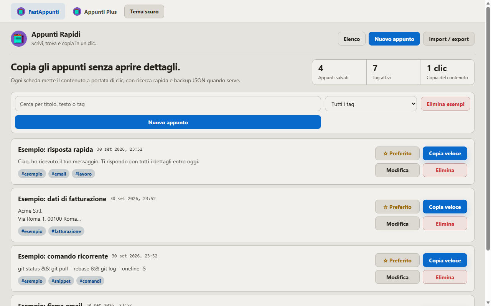
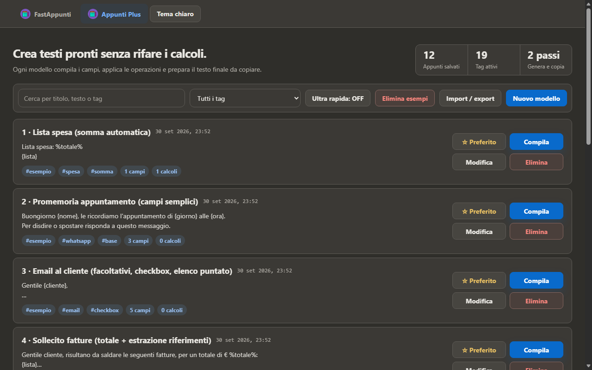
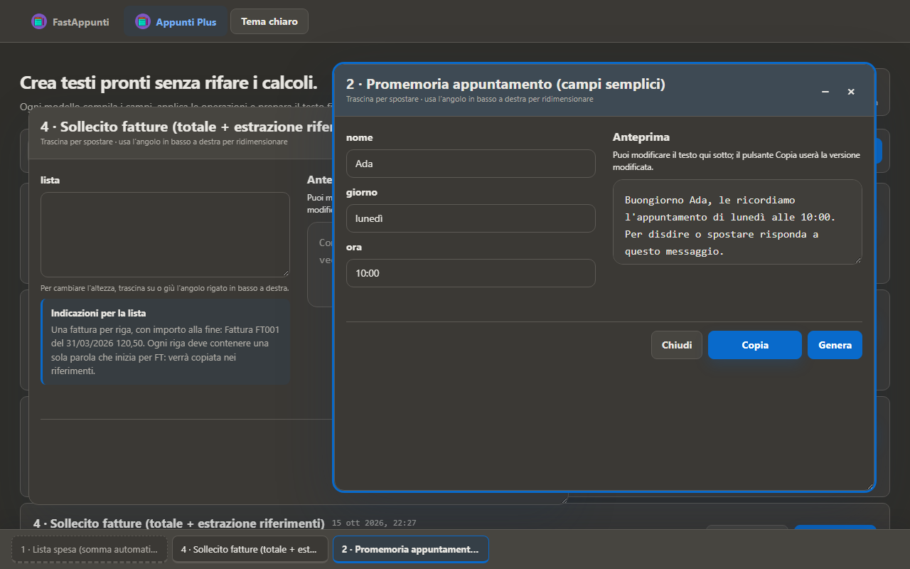
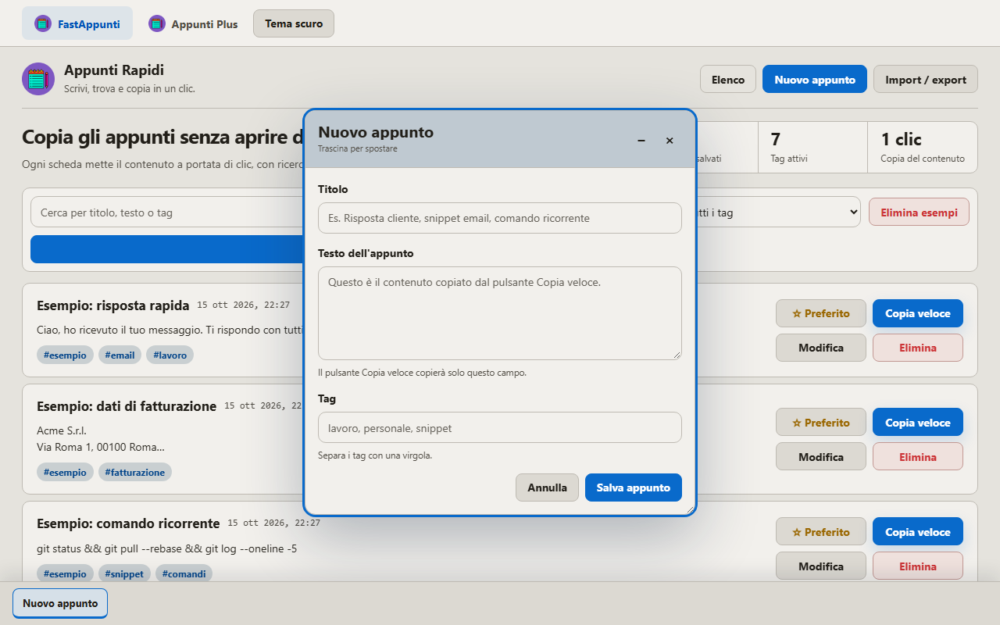
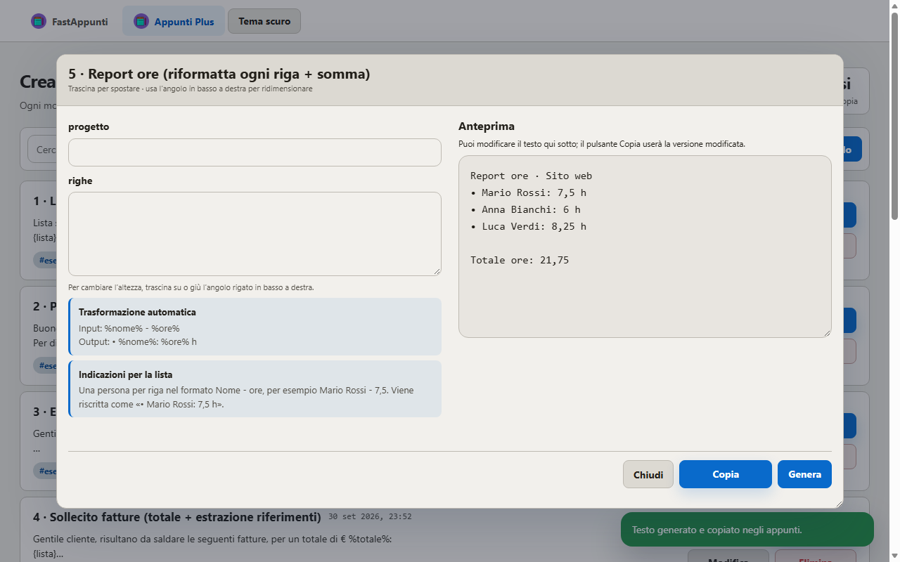
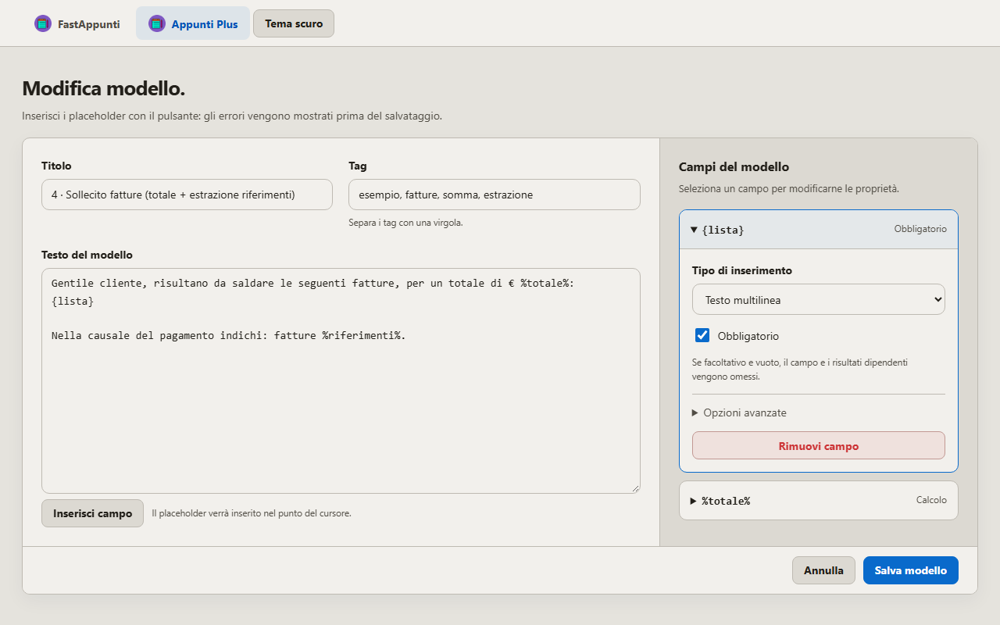
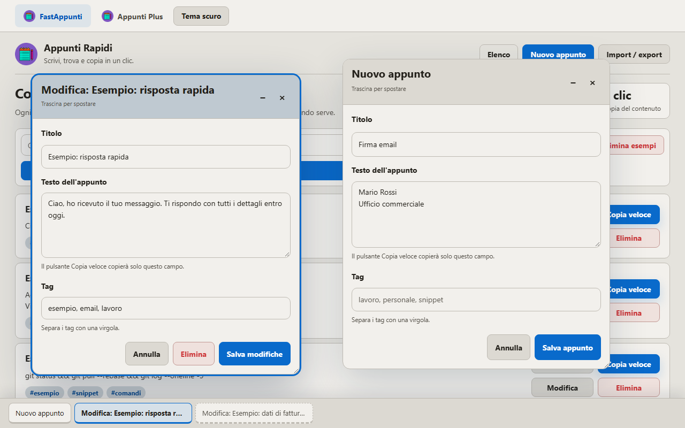
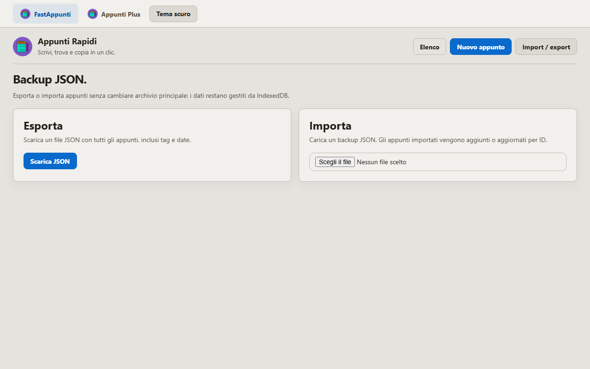

<div align="center">


# FastAppunti

**Write, find and copy in one click.**
A notes and text-template manager that lives entirely in your browser: no server, no account, no installation.

`100% client-side` · `zero dependencies` · `no server` · `works offline` · `about 230 KB`

**[▶ Try it online](https://zsimone35.github.io/FastAppunti/)** · **[Download](https://github.com/zSimone35/FastAppunti/releases/latest)**

</div>

> 🇮🇹 **In italiano:** FastAppunti è un **gestore di appunti e modelli di testo gratuito e open source** che funziona nel browser, **offline**, senza account né server. Salva i testi che scrivi sempre (risposte ai clienti, firme email, IBAN, dati di fatturazione, comandi) e **copiali in un clic**; con **Appunti Plus** compili modelli con campi e **calcoli automatici** (somme, totali) e ottieni il testo pronto da incollare. Puoi lavorare su più modelli insieme, in finestre. **[Provalo subito online](https://zsimone35.github.io/FastAppunti/)** oppure scarica lo ZIP e apri `appunti.html`.

---

## What is it

FastAppunti is a small tool for people who keep typing the same things: replies to customers, email signatures, billing details, commands, reminders, reports. Instead of digging through old chats or documents, you have them one click away and copy them to the clipboard in a single gesture.

It is **two applications** in the same folder, linked by a bar at the top:

| | FastAppunti | Appunti Plus |
|---|---|---|
| **Used for** | Fixed texts to reuse | Fillable templates with fields and calculations |
| **Example** | Email signature, IBAN, recurring command | Invoice reminder with automatic total |
| **Main action** | **Quick copy** | **Fill in → Generate → Copy** |
| **File to open** | `appunti.html` | `appunti-plus.html` |

<p align="center">
  
  
</p>

> **Note:** the application interface is in Italian.

### New in 2.6: work in windows

Forms now open as **windows inside the page**: fill in several templates at once, minimize them to the **taskbar at the bottom** and pick them up again with one click. [See how it works ↓](#windows-and-taskbar)

<p align="center">
  
</p>

---

## Everything runs on your computer

This is the core idea of the project.

- **No server.** There is no backend, no remote database, no API. It is just plain HTML, CSS and JavaScript files.
- **No network.** The code makes no HTTP requests and loads nothing from CDNs, external fonts or scripts. Once the folder is downloaded it works without a connection.
- **Your data stays in your browser.** Notes are stored in **IndexedDB**, the database built into the browser. They never leave your device.
- **Featherweight.** No framework, no build step, no `npm install`. The whole application weighs about 230 KB.
- **Client-first.** Open the file and it works. Nothing to configure, nothing to start, nothing to keep running.

> Practical consequence: if you clear the site data in your browser, you also clear your notes. That is why JSON export exists (see [Backup](#backup-import--export)).

---

## Getting started

### 1. Download the project

```bash
git clone <repository-URL>
```

or download the ZIP from GitHub (**Code → Download ZIP**) and unzip it.

### 2. Open it

Double-click **`appunti.html`** (or `appunti-plus.html`). It opens in your default browser.

That's all. On first launch you will find a few ready-made examples to try; when you no longer need them, the **Elimina esempi** ("Delete examples") button removes them all at once.

> Tip: keep the files in the same folder and bookmark the page you use the most.

### Supported browsers

It works in modern browsers. The **always-on-top quick panel** uses the Document Picture-in-Picture API, available in **Chrome / Edge 116 or later**. In other browsers the panel still opens, but in a regular window.

---

## FastAppunti: copy in one click

Create a note with a title, text and tags. From the list you copy it with **Copia veloce** ("Quick copy"), without opening it.

- Instant search by title, text or tag
- Tag filter
- **Favourite** notes pinned up front
- New, edit and delete in **windows** over the list, so you can keep several notes open at once
- Light and dark theme (follows the system, or you choose)

<p align="center">
  
</p>

---

## Appunti Plus: ready-made texts, no recalculating

A template is a text with **placeholders**. You fill it in once, the app generates the final text and copies it for you.

- `{field}` is a field you type
- `%result%` is a value **calculated** by the app

Example template:

```text
Lista spesa: %totale%
{lista}
```

Enter one item per line, with the price at the end:

```text
Latte 1,29
Pane 2,10
Uova 3,40
```

The app adds up the last number of each line and produces the complete text, with the total already calculated.

<p align="center">
  
</p>

### What templates can do

| Feature | Description |
|---|---|
| **Simple fields** | Single-line or multi-line text |
| **Optional fields** | If left empty, they are left out of the final text |
| **Checkboxes** | Add a fixed sentence only when ticked |
| **Calculations** | **Sum**, **multiplication** and **subtraction** of the numbers found in a field |
| **Per-line prefix** | Automatically puts a symbol in front of every line (`•`, `✔`, `☐`…) |
| **Reformatting** | Rewrites each line in a different format (e.g. `Mario Rossi - 7,5` → `• Mario Rossi: 7,5 h`) |
| **Extraction** | Collects into a list the codes that start with a given prefix (e.g. invoice numbers) |
| **Validation** | Configuration errors are shown before saving |

<p align="center">
  
</p>

### Fill in several templates at once

Each **Compila** opens its own window, so you can work on different templates side by side. Clicking *Compila* on a template that is already open brings its window back to the front.

### "Ultra rapida" (ultra-fast) mode

For templates with a single manual field, turning on **Ultra rapida** lets one click on *Compila* ("Fill in") do everything: the app reads the text already on your clipboard, processes it with the template and puts the result back on the clipboard. If the content does not match, it tells you why instead of producing a wrong text.

### 12 built-in example templates

From the simplest to the most complete: shopping list, appointment reminder, customer email, invoice reminder, hours report, expense report, area or volume, remaining budget, meeting minutes, order confirmation, mileage reimbursement, release notes.

---

## Windows and taskbar

In both apps, the forms for entering data open as **windows inside the page**, like on Windows:

- Drag a window by its title bar. Each one has **–** (minimize) and **×** (close).
- The **active window** comes to the front and has a coloured outline. **Enter** only acts on that window, even when two or three are open.
- A **taskbar at the bottom** lists every open window. Click a button to restore that window or bring it to the front. Click the active one again to minimize it.
- Windows stay open while you switch views on the same page, for example to *Import / export*.

<p align="center">
  
  
</p>

---

## Quick panel

The **Apri pannello rapido** ("Open quick panel") button at the top opens a small, movable window with all your notes and templates, ready to browse and copy while you work in another application. In Chrome or Edge it stays **always on top of other windows**.

---

## Backup: import / export

Each section has its own **Import / export**:

- **Export** downloads a JSON file with your notes or templates.
- **Import** adds the new ones and updates those with the same ID.

For Appunti Plus the export contains only templates, placeholders and operations: the values you filled in stay on the device. It is also the easiest way to **move your data to another computer** or to keep a backup.

<p align="center">
  
</p>

---

## Project structure

```text
.
├── index.html             # presentation page (GitHub Pages)
├── sitemap.xml            # page list for search engines
├── appunti.html           # FastAppunti: notes to copy
├── appunti-plus.html      # Appunti Plus: templates with fields and calculations
├── app.js                 # application logic
├── quick-panel.js         # quick panel
├── theme.js               # light / dark theme
├── styles.css             # styles
├── fastappunti-icon.png   # icon
├── test-fields.cjs        # field logic test (optional)
├── LICENSE                # MIT License
└── docs/img/              # images used in this README
```

## Tests

The field and calculation logic has a test that needs neither a browser nor dependencies. You only need [Node.js](https://nodejs.org):

```bash
node test-fields.cjs
```

---

## License

Released under the [MIT License](LICENSE). Current version: **release 2.6**.
